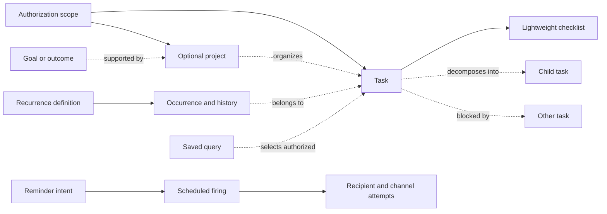

# Task and project semantics: evidence for Daymark

Research date: **2026-11-09 (UTC)**. Status: **finalized bounded research**, with proposed design guidance; not a claim that Daymark has implemented these capabilities. All examples are synthetic. This report describes a general-purpose core for individuals, groups, and organizations. Household examples are test cases, not the product's organizing principle.

Daymark should borrow **semantic separation**, rather than copy one application's hierarchy: separate authority from organization, outcomes from actions, availability from plans and deadlines, recurrence definitions from occurrence history, and reminder intent from delivery. These distinctions recur across the primary sources, but their implementations differ enough that a feature checklist would hide consequential incompatibilities.

The smallest useful core is an independently addressable task within an explicit authorization scope, optional project and parent relationships, typed temporal values, explicit recurrence policy, and queryable lifecycle history. Add goals, checklists, views, integrations, and richer collaboration without making them prerequisites for capturing a task. Treat reliable reminders and loss-aware export as contracts requiring their own evidence.

The bounded survey is closed: **13 product families** (the 10 requested systems plus 3 additional open-source references), with GTD methodology and iCalendar as separate reference families. Remaining unknowns are listed explicitly; they do not mean unsupported features and do not require the engine work to wait.

Read this with [the source inventory](research-sources.json) and [the decision trace](adr-comparison.md). Source IDs in links match the JSON inventory. Source claims below are paraphrases of inspected documentation or source; recommendations and deductions are labeled as such.

Coverage receipt: **111 retained primary sources**, **30 claim records**, and **16 proposed decision records**. Retrieval attempted **174 distinct primary URLs** through **183 document-retrieval attempts**. There were **44 failed extraction attempts** and **10 rejected navigation shells**; four initially failed URLs were later recovered into the retained evidence, while 39 failed URLs have no retained recovery. Several other short/noncontent attempts are separately classified. Many failed paths were replaced by working canonical pages; these counts do not mean 39 unresolved feature gaps.

## Reading the evidence

**Documented** means the primary source describes the behavior. It does not mean it was tested in an installed application. **Source-observed** means a relevant implementation path was inspected, without executing it. **Unknown** means this research did not establish a contract. **Explicitly unsupported** is reserved for a source that actually rules something out. An omitted API field, an inaccessible help page, or a blank comparison-table cell alone is not proof of general product absence.

The sources are not independent trials. Multiple pages from one publisher explain one product; they do not independently corroborate reliability. API schemas establish representation and validation contracts. User guides establish intended interactions. Source establishes only the inspected code path and revision snapshot. Marketing establishes a publisher's claim. None establishes actual deployment configuration, uptime, notification receipt, human attention, or absence of defects.

Preferred research discovery produced no qualifying evidence. Known URLs were retrieved through a document extraction service, initially with direct retrieval. JavaScript-rendered documentation required browser extraction or a labeled web-reader/index fallback. Navigation shells were rejected even when the retrieval service reported success. Failed and replaced URLs remain in the sanitized inventory. The public inventory contains primary URLs, retrieval dates, evidence coordinates, short original summaries, and limitations; it contains no full-text captures, local capture paths, internal service identifiers, or credentials.

The comparison uses current retrieved documentation, with explicit version bounds where provided. In particular, the OmniFocus **4.10.1** manual supersedes the initially encountered **4.3.3** manual for current scheduling claims. OmniFocus 4.7 introduced planned dates; an older two-date comparison would now be misleading. Some Vikunja pages describe version-gated or unstable features; those statements are not proof that an arbitrary deployed instance provides them. [O07](https://support.omnigroup.com/documentation/omnifocus/universal/4.10.1/en/outline/), [V05](https://vikunja.io/help/projects/).

No application was installed, no production account was exercised, and no end-to-end delivery, concurrency, DST, or migration test was run. At initial inspection, the assigned project directory contained no implementation or product specification. Local-fit recommendations therefore derive from the supplied general-purpose brief, not a code audit. Later implementation may differ.

## Questions the core must answer

| Dimension | Questions hidden behind a feature name |
| --- | --- |
| Scope | Who owns the data? Is workspace membership enough to read every project? Is a team a group of principals or a container of work? What survives the creator leaving? |
| Structure | Is a project a finite outcome, an ongoing list, or a permission boundary? Is a subtask an independently assignable task or a text checkbox? Can one task belong to multiple projects? |
| Time | Does a date constrain eligibility, express intention, impose a cutoff, reserve calendar time, or record an event? Does date-only mean a civil day or midnight? |
| Recurrence | Is the next time anchored to the calendar, scheduled occurrence, or actual completion? Does late work accumulate, skip, or coalesce? Is the same task reused? |
| Reminder | What event schedules it? Who receives it? Is its time absolute or relative? What happens after edit, completion, restart, outage, or duplicate callback? |
| Dependency | Is the relation informative, a completion guard, an availability rule, or a date-shifting constraint? Can it cross an access boundary? |
| View | Is it a saved query or a container? Whose permissions and timezone evaluate it? Does it refresh as time passes? |
| Portability | Does export include completed work, attachments, recurrence anchors, identifiers, and permission semantics? Can it round-trip? |

## 1. Scopes, teams, ownership, and permission

A single term such as “workspace” cannot stand in for principal membership, data ownership, grouping, and visibility. Todoist distinguishes personally controlled projects from team-owned projects. Its team roles include admin, member, and project-limited guest, with plan-specific availability; joining a shared personal project grants editing access to that project rather than team governance. Its documentation also says team work cannot simply be moved out into personal space. Those are custody decisions, not merely sidebar organization. [T09](https://www.todoist.com/help/account-and-billing/teams/team-roles-and-access-uGkyLrJQz), [T10](https://www.todoist.com/help/account-and-billing/teams/work-with-others-in-todoist-WOpFVjup7), [T11](https://www.todoist.com/help/account-and-billing/teams/teams-faq-lQhBHo0y6).

Vikunja separates membership administration from project rights. A team admin manages team membership; that role does not automatically mean project admin. Projects can be shared with users, teams, or bearer links, using read, read/write, or admin permissions. A link can grant project access without an account, and revoking it is a security operation. The inspected task guide allows multiple assignees, but only among people who already have project access: assignment follows access rather than defining it. [V11](https://vikunja.io/help/sharing-and-teams/), [V20](https://vikunja.io/help/permissions/), [V04](https://vikunja.io/help/tasks/).

Asana demonstrates why flexible organization makes permission rules more difficult. A single task can be in multiple projects. Its permission guide says the highest role across those projects applies, and assignment can temporarily elevate some capabilities. The same guide contains tension between the prose for viewers and its summary table's comments/likes row. Preserve that ambiguity; do not invent a fully consistent capability matrix. Linear places issues in teams inside a workspace; public-team visibility extends beyond joined members, while private teams restrict visibility. Its initiative guide separately discusses workspace-level and private-team initiatives. [S05](https://help.asana.com/s/article/task-permissions), [S06](https://help.asana.com/s/article/multi-home-tasks-to-avoid-information-silos), [L05](https://linear.app/docs/teams), [L06](https://linear.app/docs/initiatives).

Things is a useful counterexample: the publisher explicitly says it does not support real-time sharing of tasks or lists. App purchase sharing is a separate matter. Its deprecated contact-assignment feature records a person in a personal database; that is not evidence of collaborative task delivery or a permission grant. Tasks.org's sharing depends on the synchronization service; its cloud guest program grants access to shared lists but limits guests' independent cloud-list creation. Org headings and Taskwarrior project attributes do not by themselves establish an application-level team ACL. [H08](https://culturedcode.com/things/support/articles/2803552/), [H10](https://culturedcode.com/things/support/articles/2803571/), [A02](https://tasks.org/docs/sync/), [A10](https://tasks.org/docs/cloud_family/), [G15](https://orgmode.org/manual/Document-Structure.html), [W14](https://taskwarrior.org/docs/examples/).

**Recommendation — borrow:** make authorization scope explicit and durable. Keep `creator`, responsible person, collaborators, scope owner, and role grants conceptually distinct. A team is a reusable principal group; a project organizes work; a saved view selects work. For an initial implementation, one explicit owner scope per task is easier to explain than permission unions across multiple project homes. Any later cross-scope link should display a reference only to authorized readers, without leaking titles, counts, identities, reminder text, or attachment URLs. A private item appearing in a shared view must not become shared by implication.

**Reject as a default:** silently widening access when work is regrouped or assigned. **Defer:** public bearer links, nested role overrides, custom enterprise roles, and multi-home permission unions until the product explicitly needs them. This is a design recommendation, not a claim that these mechanisms are inherently wrong in the products that provide them.

## 2. Hierarchy, outcomes, projects, tasks, and checklists

| Family | Documented organizational mechanism | Semantic consequence |
| --- | --- | --- |
| Todoist | Project, section, parent task, labels, assignee and workspace representations in the API | A grouping section and a parent task are different entities; hierarchy does not itself prove dependency enforcement. [T06](https://developer.todoist.com/api/v1/) |
| Things | Areas and projects exposed by local automation; project headings; to-dos with checklist items | Ongoing responsibility, finite project, visual heading, and task detail have different roles. A checklist line is not automatically a full task. [H05](https://culturedcode.com/things/support/articles/2803573/) |
| OmniFocus | Folders, projects, nested action groups and actions; sequential, parallel, and single-action project modes | Containment can affect availability; a single-action list need not represent one finite outcome. [O07](https://support.omnigroup.com/documentation/omnifocus/universal/4.10.1/en/outline/), [O10](https://support.omnigroup.com/documentation/omnifocus/universal/4.10.1/en/perspectives/) |
| TickTick | Folder → list → section → task → subtask in the FAQ; checklist-based progress in task details | Its own documentation distinguishes subtask structure and check-item progress. Full nesting limits and inheritance need separate verification. [K05](https://help.ticktick.com/articles/7055792921664028672), [K04](https://help.ticktick.com/articles/7055782408586526720) |
| Org | Outline headings, TODO states, properties, checkbox lists, agenda files | Rich structure is conventional and configurable; “project” need not be a mandatory entity type. [G15](https://orgmode.org/manual/Document-Structure.html), [G10](https://orgmode.org/manual/Properties-and-Columns.html), [G16](https://orgmode.org/manual/Checkboxes.html) |
| Taskwarrior | Task attributes; one project string, with dotted naming for project hierarchy; tags and UDAs | A dotted project label is not the same thing as nested task records. [W14](https://taskwarrior.org/docs/examples/), [W04](https://taskwarrior.org/docs/udas/) |
| Vikunja | Nested projects; task relations include parent/subtask, blocked/blocking, duplicate and related | Structural and causal relations are independently represented. [V05](https://vikunja.io/help/projects/), [V21](https://raw.githubusercontent.com/go-vikunja/vikunja/main/pkg/models/task_relation.go) |
| Tasks.org | Lists and multilevel subtasks, with backend-specific limits | Android-side structure may exceed what a particular synchronized service preserves. [A02](https://tasks.org/docs/sync/) |
| Asana | Workspaces, teams, projects, task/subtask parent, milestones, goals and custom fields | A task may have multiple project memberships; a milestone is not simply an ordinary task with a label. [S02](https://developers.asana.com/docs/tasks), [S07](https://developers.asana.com/docs/workspaces), [S08](https://developers.asana.com/docs/teams), [S09](https://developers.asana.com/docs/goals) |
| Linear | Workspace/teams, projects, parent/sub-issues, initiatives | Strategic grouping, issue hierarchy, and team workflow are separate axes. [L05](https://linear.app/docs/teams), [L14](https://linear.app/docs/parent-and-sub-issues), [L06](https://linear.app/docs/initiatives) |

GTD is a method, not a competing storage schema. Its official explanation distinguishes capture, clarification, organization, review, and engagement; a project is identified when an actionable outcome needs more than one action. Its horizons distinguish actions, projects, ongoing responsibilities, longer-range objectives, vision, and purpose. This supports a model in which goals relate to projects, rather than becoming giant tasks that auto-complete when the last checkbox is checked. These are methodological categories, not evidence that one application implements every horizon. [D01](https://gettingthingsdone.com/what-is-gtd/), [D02](https://gettingthingsdone.com/2011/01/the-6-horizons-of-focus/).

**Recommendation — borrow:** keep optional areas/responsibilities, outcome-oriented projects, atomic tasks, and lightweight checklists distinguishable. Permit an uncategorized task. A project should be completable or archivable independently of whether every historical child is done; if automatic completion is desired, make it a policy with visible consequences. Promote a checklist item to a task when it needs its own assignee, dates, reminders, dependencies, comments, or history. Promotion must preserve text and order and explain any new authority boundary.

**Recommendation — try:** start with one task parent and an acyclic tree for decomposition, separate dependency edges for causal order, and separate goal/project associations for strategic contribution. Defer a universal arbitrary graph. The latter can express more, but makes moves, completion rollups, ACL inheritance, export and recurrence cloning harder to explain.

## 3. Temporal semantics: dates are not interchangeable

Use separate meanings before choosing field names. A hard deadline means missing a cutoff is late. A planned day or window means intended work, which may move without changing the commitment. Availability means work should not be offered before a boundary. A latest preferred target can be missed without declaring a contractual deadline breach. An actual start/completion timestamp is historical evidence, not a future plan.

| Product | Verified meaning | Important boundary or uncertainty |
| --- | --- | --- |
| Todoist | User-facing date schedules work; deadline is the cutoff. API deadline is date-only and nonrecurring. Due objects distinguish date-only, floating local time, and timezone-related time representations. | The API's legacy `due` terminology does not turn every user-facing scheduled date into a hard deadline. There is no verified independent earliest/latest soft window contract in this survey. [T07](https://www.todoist.com/help/articles/introduction-to-deadlines-in-todoist-uMqbSLM6U), [T06](https://developer.todoist.com/api/v1/) |
| Things | “When” controls attention/start day; a future start hides work in Upcoming; deadline is the must-finish day. A reminder adds a time to attract attention. | A start day is not a reserved calendar interval. A freely queryable separate latest-soft-target field was not established. [H01](https://culturedcode.com/things/support/articles/2803579/) |
| OmniFocus 4.10.1 | Defer is availability; planned is intention; due is completion cutoff. Parent defer/due constrain children, while parent planned dates provide defaults without the same constraint. | Current three-date semantics must not be replaced with older two-date descriptions. Date input can imply a time, rather than retain an explicit all-day type. [O07](https://support.omnigroup.com/documentation/omnifocus/universal/4.10.1/en/outline/), [O08](https://support.omnigroup.com/documentation/omnifocus/universal/4.10.1/en/inspector/) |
| TickTick | Tasks support date/time, timed duration and multiday all-day duration. | Those fields do not establish an independent immutable deadline plus a movable soft planning window. This distinction remains unknown, not absent. [K04](https://help.ticktick.com/articles/7055782408586526720) |
| Org | DEADLINE is completion timing; SCHEDULED is when to start working, not a meeting reservation. Plain timestamps can place appointments in an agenda. Warning and display delays are separately configurable. | Carry-forward agenda behavior is a view rule; it does not prove an external reminder was sent. Timestamp semantics depend on configuration. [G01](https://orgmode.org/manual/Deadlines-and-Scheduling.html) |
| Taskwarrior | `due` is last on-time moment; `scheduled` expresses readiness; `wait` hides until; `start` in the task model records actual work start. | A date entered without time is represented at local midnight. `until` is expiration/deletion behavior, not a harmless latest soft target. Older guide language for waiting state must be read beside the current manual. [W13](https://taskwarrior.org/docs/using_dates/), [W02](https://taskwarrior.org/docs/dates/), [W16](https://taskwarrior.org/docs/man/task.1/), [W17](https://taskwarrior.org/docs/task/) |
| Vikunja | Due is completion cutoff; start/end form a planned work window used by Gantt. A configured default time can be applied to date input without a time. | A date picker accepting a day does not prove storage preserves a date-only value. “Start/end” here do not automatically impose availability guards. [V10](https://vikunja.io/help/dates-and-reminders/) |
| Tasks.org | Sync documentation distinguishes due date, due time and start time, with backend differences. | Independent hard/soft windows and cross-client timezone fidelity were not established. [A02](https://tasks.org/docs/sync/) |
| Asana | API distinguishes localized `due_on` from UTC `due_at`, and `start_on` from `start_at`; paired alternatives cannot be supplied together. Start mutations have due-field requirements. | A range ending at due is not an independent soft finish window plus hard deadline. The API field contract is stronger evidence than calendar appearance. [S02](https://developers.asana.com/docs/tasks) |
| Linear | Issues have due dates; projects/initiatives can express higher-level targets, and teams have timezones. | Do not map an initiative target to a hard issue deadline or infer issue-level availability fields from project scheduling. Detailed due-page retrieval was incomplete. [L16](https://linear.app/docs/issue-properties-home), [L06](https://linear.app/docs/initiatives), [L05](https://linear.app/docs/teams) |

### Day-only, local clock time, zoned schedule, and instant

These four representations should remain distinct:

1. **Civil date:** a task due on a day, such as `2027-04-20`, without claiming midnight UTC or a particular hour.
2. **Floating local date/time:** “09:00 wherever the relevant person is.” Changing timezone changes the corresponding instant.
3. **Zoned wall-clock schedule:** “09:00 in Europe/Berlin.” The IANA timezone and calendar rule determine each occurrence's instant, including DST.
4. **Instant:** an unambiguous timestamp such as `2027-04-20T12:00:00Z`, used for actual completion, dispatch attempt, or a fixed worldwide event.

Todoist and OmniFocus explicitly document floating versus fixed behavior. Todoist says due times default to floating: collaborators in different zones can each see 09:00, meaning different real moments. OmniFocus's inspector likewise distinguishes floating and fixed, including custom notifications. This is a real product choice, not a universal timezone convention. [T08](https://www.todoist.com/help/todoist/features/set-a-fixed-time-or-floating-time-for-a-task-YUYVp27q), [O08](https://support.omnigroup.com/documentation/omnifocus/universal/4.10.1/en/inspector/).

**Recommendation — borrow:** retain date precision and zone policy in the core. Convert to an instant only for an operation that requires one. A civil-day deadline should remain on the same labeled date when a viewer changes zone. If reminders need a time for that day, use an explicit user/scope preference rather than silently changing the deadline into midnight. For a date-only cutoff, define lateness at the next day's boundary in the chosen governing zone; record that zone policy so two readers do not get unexplained conflicting states.

A soft window needs start/end values and an explicit interpretation: “prefer sometime during these days” differs from “must occupy every hour between these timestamps.” A soft latest target remains separate from a hard deadline. Conflicting values, such as availability after a deadline, deserve a visible conflict state; silently moving a deadline to make a form valid destroys meaning.

## 4. Recurrence: anchor, materialization, and missed-work policy

| System | Anchor and advancement established by evidence | Identity/history implication |
| --- | --- | --- |
| Todoist | `every` calendar-style versus `every!` completion-based recurrence; completion advances the date. Late daily completion has documented future-date behavior. | UI recurrence is not proof of independently persisted future task rows; series/history representation must be verified separately. [T03](https://www.todoist.com/help/articles/introduction-to-recurring-dates-YUYVJJAV) |
| Things | Regular and after-completion patterns; templates create future to-dos/projects. Repeating deadlines can appear earlier by a configured lead in days. | Editing the template versus an occurrence is consequential. Repeating deadline lead time is richer than simply copying one fixed date. [H02](https://culturedcode.com/things/support/articles/2803564/) |
| OmniFocus | Regular or from-completion; explicit catch-up option; basis can be defer, planned or due. Completion-based repeats use documented rounding by unit. | Catch-up skips past occurrences; disabling it may create an overdue next occurrence. Nested repeated containers/actions can duplicate unexpectedly. [O08](https://support.omnigroup.com/documentation/omnifocus/universal/4.10.1/en/inspector/) |
| TickTick | Due-date, completion-date and specific-date modes; end by date/count and editing one recurrence are documented. | Its wording mixes recurrence and next reminder time. Do not infer a persistent occurrence ledger or a delivery guarantee from that wording. [K03](https://help.ticktick.com/articles/7055782206349770752) |
| Org | `+` advances one interval; `++` advances to a future matching interval; `.+` follows completion/current time. Completing a repeat shifts timestamps and restores TODO state, with optional logging. | The same entry changes; old agenda placement disappears unless separately recorded. Multiple repeated timestamps advance, while nonrepeated scheduling can be removed. [G02](https://orgmode.org/manual/Repeated-tasks.html) |
| Taskwarrior | Hidden recurring template plus linked generated instances; configurable lookahead. | The recurrence parent is a template relation, not ordinary subtask decomposition. Lookahead is not “spawn one whenever completed.” Completion-based recurrence is unestablished here. [W01](https://taskwarrior.org/docs/recurrence/) |
| Vikunja | Fixed interval, monthly same-day with shorter-month clamping, or from completion. Completion advances dates/reminders and leaves the same task open. | The guide says it does not create a new task and resets description checklists. It explicitly says more flexible weekday/ordinal rules are not yet supported. [V10](https://vikunja.io/help/dates-and-reminders/) |
| Tasks.org | Due-anchored or completion-anchored; intervals and date/count endings. | Repeat-after-completion is separately documented in the app, but the sync table does not mark it preserved. Do not assume backend round-trip fidelity. [A04](https://tasks.org/docs/recurrence/), [A02](https://tasks.org/docs/sync/) |
| Asana | Completion duplicates the task for the next due date; periodical recurrence is completion-based. Comments excluded; subtasks copied. | Parent and child repeats together can produce exponential duplication, according to the guide. [S04](https://help.asana.com/s/article/scheduling-tasks-using-start-dates-due-dates-and-times) |
| Linear | Scheduled future issues expected after the prior due date passes, at 00:01 the following day in the team's timezone. Template changes do not update existing recurring definitions. | Completion is not the documented generation trigger. This is useful for recurring obligations that must exist even when previous work remains open. [L03](https://linear.app/docs/creating-issues) |

### Calendar rules and DST

RFC 5545 distinguishes DATE, floating DATE-TIME, UTC DATE-TIME, and DATE-TIME with TZID; recurrence combines a start with rules/additions/exclusions. Sections 3.3.5 and 3.3.10 specify handling of ambiguous/nonexistent local times and invalid generated dates, including excluding invalid recurrence instances. That contract differs from a product intentionally clamping “monthly on the 31st” to the last day of shorter months. Vikunja documents clamping; it should not be advertised as identical to arbitrary RFC recurrence. The standard describes interchange semantics, not proof that any surveyed application conforms in every case. [R01](https://www.rfc-editor.org/rfc/rfc5545), [V10](https://vikunja.io/help/dates-and-reminders/).

**Analysis:** daily at 09:00 in a DST-observing zone and every 24 elapsed hours describe different schedules. The former may have 23- or 25-hour gaps between instants; the latter may change local clock hour. “Three days after completion” still needs a decision about elapsed duration versus calendar-day arithmetic, preservation of local time, and rounding. OmniFocus documents rounding; Org distinguishes date- and hour-based repeat examples. Most other retrieved user guides do not specify all these edge cases. Mark per-product DST gap/fold behavior **unknown** unless a tested or explicit contract is available.

**Recommendation — borrow:** represent the recurrence basis and calendar/elapsed arithmetic separately. Record the governing timezone, anchor, end condition, invalid-day policy, missing-local-time policy, ambiguous-local-time policy, and missed-occurrence policy. Preserve immutable occurrence identity and its original scheduled slot. Distinguish completing, skipping, cancelling, and ending the series. Editing an occurrence should not silently rewrite the series; editing the series needs a defined “this and future” boundary.

**Recommendation — try:** implement two comprehensible initial families: calendar-fixed rules and after-completion intervals, with an explicit preview of the next few dates. Keep history even if the UI shows one current task. Use an occurrence key derived from series identity and nominal slot, not a new random identifier on every scheduler retry. Bound materialization and catch-up so a ten-year outage cannot enqueue unbounded work. Defer natural-language recurrence parsing, arbitrary business calendars and nested repeating projects until the core behavior is demonstrable.

### Missed-work examples

All are synthetic, including any household setting:

| Intention | Correct policy to choose explicitly | A misleading substitute |
| --- | --- | --- |
| Submit an independent report every Monday | Keep each obligation, or consciously coalesce missed ones | Treat completion today as a new weekly anchor |
| Replace a household filter three months after replacement | Anchor next work to actual completion with a declared calendar rule | Accumulate three overdue replacements because three slots passed |
| Check equipment daily when practical | Skip missed slots while preserving the daily cadence | Declare every missed day completed |
| Plan work on a report sometime next week, deadline next month | Move the plan/window without moving the cutoff | Use one due field for both meanings |

## 5. Reminders, notifications, delivery, and outbox semantics

A task recurrence creates another obligation or advances a schedule. A recurring reminder repeats attention for the same unfinished obligation. Tasks.org explicitly documents these as different features. A notification about assignment or a comment is a third category. An integration webhook is a fourth. Conflating them produces duplicate obligations, unexpected reminders, and incorrect reliability claims. [A03](https://tasks.org/docs/notifications/), [A04](https://tasks.org/docs/recurrence/).

| Product | What the inspected evidence supports | What remains unproved |
| --- | --- | --- |
| Todoist | Automatic, custom absolute/relative, recurring and location reminders; notification-channel preferences. Automatic relative reminders require task date and time. | Durable scheduling, crash recovery, provider acceptance/receipt, transactional outbox, retry ordering and exactly-once attention. [T05](https://www.todoist.com/help/articles/introduction-to-reminders-9PezfU) |
| Things | Reminder time attracts attention; templates can include reminders. | Internal dispatch ledger, cross-device dedupe, missed-reminder replay, and outage recovery. [H01](https://culturedcode.com/things/support/articles/2803579/), [H02](https://culturedcode.com/things/support/articles/2803564/) |
| OmniFocus | Date-related and custom notifications; custom notifications are removed from the next repeat; timezone mode applies. | Guaranteed delivery during device sleep/offline use or persistent retry internals. [O08](https://support.omnigroup.com/documentation/omnifocus/universal/4.10.1/en/inspector/) |
| TickTick | Reminders and constant-reminder setup/troubleshooting appear in help; OS permissions and background settings matter. | Service-side outbox/retry, cross-device cancellation and delivery receipt. [K05](https://help.ticktick.com/articles/7055792921664028672) |
| Org / Taskwarrior | Agenda warnings/ready/overdue reports are documented. Hooks and extension surfaces can support further behavior. | A complete built-in external notification service was not established. Do not turn an agenda row into a push-delivery claim. [G01](https://orgmode.org/manual/Deadlines-and-Scheduling.html), [W13](https://taskwarrior.org/docs/using_dates/), [W05](https://taskwarrior.org/docs/hooks/) |
| Vikunja | Absolute and date-relative reminders, in-app notifications and optional email. Source inspection shows a minute cron scan, subscriber selection, in-memory suppression within a scan, and calls into notification dispatch. | The inspected file does not establish a durable per-occurrence delivery ledger, end-to-end exactly-once behavior or outage catch-up. A local `seen` map is not durable deduplication. [V10](https://vikunja.io/help/dates-and-reminders/), [V18](https://raw.githubusercontent.com/go-vikunja/vikunja/main/pkg/models/task_reminder.go) |
| Tasks.org | Initial relative reminders plus repeated reminders with intervals/limits. | OS/provider delivery, missed-run replay, and full sync preservation of all reminder types. [A03](https://tasks.org/docs/notifications/), [A02](https://tasks.org/docs/sync/) |
| Asana | Recurrence and collaboration semantics are documented; its webhook guide has a separate transport contract. | Reminder transport internals cannot be inferred from webhook retries. [S04](https://help.asana.com/s/article/scheduling-tasks-using-start-dates-due-dates-and-times), [S10](https://developers.asana.com/docs/webhooks-guide) |
| Linear | Inbox notifications and reminders for issues/documents/projects/initiatives; subscriptions to views can generate notifications. | Durable reminder outbox and end-to-end delivery guarantees. An offline edit queue is not a reminder delivery queue. [L20](https://linear.app/docs/inbox), [L07](https://linear.app/docs/custom-views) |

The Vikunja implementation observation is deliberately bounded: the inspected mutable-branch file scans reminders and dispatches notifications; other layers may provide additional storage, queuing or retries. No repository-wide proof of their presence or absence was performed. A source comment claiming a notification is stored is not a transaction/restart test. The narrow scan window suggests a useful outage-recovery test; it does not establish an observed production failure. [V18](https://raw.githubusercontent.com/go-vikunja/vikunja/main/pkg/models/task_reminder.go).

Asana's webhook guide is a particularly useful counterexample to simplistic reliability language. It describes the system as at-most-once with possible missing events and no replay, while also documenting resends on failed acknowledgments for up to 24 hours. Preserve both statements: transport retries do not imply a complete replayable change log. It recommends polling when missed changes are unacceptable. This contract belongs to integration events, not task reminders. [S10](https://developers.asana.com/docs/webhooks-guide).

### Proposed Daymark contract

**Recommendation — borrow the separation, design the mechanism independently:** a reminder definition expresses intent; a scheduled firing refers to a task/occurrence and version; a recipient/channel delivery records attempts and outcomes. Write domain changes and delivery intent atomically, or use an equivalent recoverable mechanism with a demonstrated reconciliation rule. Use a unique firing key so two workers do not create two logical firings.

A worker should recheck current authorization, task state, occurrence state, version, and recipient preferences before dispatch. Editing a date invalidates superseded future firings. Completion cancels pending reminders for that occurrence, while recurring reminder policies remain distinct from task recurrence. Revoking a collaborator must stop future messages and remove readable in-app content according to an explicit policy.

States should distinguish pending, leased/in progress, retryable failure, terminal failure, cancelled, expired, and provider accepted. “Provider accepted” must not be labeled “person notified” unless receipt evidence exists. A timeout after sending is ambiguous: retry may duplicate an external effect. Prefer at-least-once attempt semantics plus idempotency at each controllable boundary, and say where a provider cannot deduplicate. Exactly-once human attention is not a credible contract.

Expiry and recovery matter as much as retries. After an outage, send still-useful reminders, expire obsolete ones, and avoid a flood of missed intervals for a completed task. Keep reason codes and an inspection surface. A standalone scheduler process is compatible with this design; it needs durable state and explicit ownership/leases, not shared UI memory. This is proposed architecture, not an assertion about Daymark's current engine or any competitor's internals.

## 6. Dependencies, availability, and completion

Dependency can mean at least four different things: a displayed relation; a guard against completing a parent too soon; a rule that hides unavailable work; or a scheduling constraint that moves dates. These should not share one ambiguous boolean.

Org can enforce child TODO and checkbox completion before a parent becomes done, and an ORDERED property can block later siblings. It points to an extension for more complex cross-tree dependencies. OmniFocus sequential projects/groups affect which actions are available, while parallel projects allow multiple actions. Taskwarrior's `depends` marks blocked relationships and supports blocked reports. These are related but not identical policies. [G03](https://orgmode.org/manual/TODO-dependencies.html), [O10](https://support.omnigroup.com/documentation/omnifocus/universal/4.10.1/en/perspectives/), [W16](https://taskwarrior.org/docs/man/task.1/).

Asana's task API represents dependencies and dependents. Linear's current property index explicitly lists related/blocking/blocked relations, but the dedicated relation URL yielded only an index shell in this run, so detailed enforcement and cycle rules remain unknown. Vikunja's inspected relation source distinguishes subtask/parent, related, duplicate, blocked/blocking, and chronological relation kinds, and contains a cycle-checking path. That establishes a modeled distinction and inspected validation logic, not every UI or scheduling consequence. [S02](https://developers.asana.com/docs/tasks), [L16](https://linear.app/docs/issue-properties-home), [V21](https://raw.githubusercontent.com/go-vikunja/vikunja/main/pkg/models/task_relation.go).

OpenProject illustrates the heavier scheduling end. Its work-package guide distinguishes hierarchy from relations and gives predecessor/successor relations with working-day lag and manual-scheduling exceptions. That is a planning system with calendar arithmetic, not merely a graph of blocked tasks. Treat automatic date propagation as a separately authorized workflow: changing an upstream plan should not casually move a hard deadline. [P01](https://www.openproject.org/docs/user-guide/work-packages/work-package-relations-hierarchies/).

**Recommendation — try:** begin with explicit directed blocking edges and cycle rejection, while leaving completion possible through a visible override if the product requires it. Derive “available” from active state, scope access, availability date, and unresolved blocking edges; distinguish user-deferred work from dependency-blocked work. Keep containment separate. Define whether cancelled/skipped prerequisites satisfy an edge. Cross-scope blockers require either shared authorized detail or a neutral inaccessible-blocker indicator with no sensitive metadata. Defer lag calculations, critical-path promises and automatic date shifting.

## 7. Views and query languages

A view must not become a second copy of a task or an authorization grant. Todoist's filters select by multiple attributes and can be saved. Its guide also documents evaluation when opening a view and manual refresh for relative-time changes; a query mentioning “now” does not necessarily mean a continuously updating live predicate. Things emphasizes built-in attention lists, tags and Quick Find; no arbitrary persisted Boolean query language was established. OmniFocus offers perspectives, with custom perspectives tied to Pro. [T04](https://www.todoist.com/help/articles/introduction-to-filters-V98wIH), [H01](https://culturedcode.com/things/support/articles/2803579/), [H04](https://culturedcode.com/things/support/articles/2803581/), [H06](https://culturedcode.com/things/support/articles/2803584/), [O10](https://support.omnigroup.com/documentation/omnifocus/universal/4.10.1/en/perspectives/).

Org's custom agenda commands persist searches and composite agenda buffers; the base agenda can span selected files. Taskwarrior custom reports specify filter, columns, sorting and limits, while UDAs become queryable fields. Tasks.org's filter builder defines AND/NOT and an OR that begins a new criteria group; translating it into an arbitrary parenthesized expression without checking grouping would change meaning. [G04](https://orgmode.org/manual/Custom-Agenda-Views.html), [G08](https://orgmode.org/manual/Agenda-Files.html), [W07](https://taskwarrior.org/docs/report/), [W04](https://taskwarrior.org/docs/udas/), [A07](https://tasks.org/docs/filters/).

Vikunja distinguishes actual project storage from personal saved filters that collect tasks across projects. Its API includes null handling, sort keys, relative-date math, and an evaluation timezone; the documented default falls back to server timezone if unset. Linear saves and shares filtered views of issues/projects/initiatives; the guide explicitly says sharing a URL does not itself grant access. TickTick documents standard smart lists; advanced custom-filter grammar was not fully retrieved in this survey. Asana advanced-search retrieval failed; do not infer its capabilities from the richness of its task API. [V05](https://vikunja.io/help/projects/), [V02](https://vikunja.io/docs/filters/), [V13](https://vikunja.io/help/filters/), [L07](https://linear.app/docs/custom-views), [K05](https://help.ticktick.com/articles/7055792921664028672).

**Recommendation — borrow:** represent a saved view as a versioned query plus presentation and sharing metadata. Evaluate through the viewer's access rules. Specify null/undated handling, inclusive boundaries, stable sort tie-breakers, completed/cancelled defaults, timezone, and refresh behavior. A query builder and textual query can share one typed representation; reject malformed or unsupported expressions rather than silently ignoring them. Save identifiers, not mutable display names, for project/person references. Do not use arbitrary executable expressions as a public query interface.

## 8. Collaboration, offline work, synchronization, and export

### Mechanisms and limits

| Product | Documented collaboration/sync/export evidence | Limit that matters to Daymark |
| --- | --- | --- |
| Todoist | Shared personal/team projects; offline add/edit/delete after login; automatic reconnect sync; CSV project export and paid active-project backups | Export omits completed tasks and recurrence start anchors. Backups omit completed tasks and archived projects and contain attachment links. Offline conflict resolution is not specified by the short guide. [T10](https://www.todoist.com/help/account-and-billing/teams/work-with-others-in-todoist-WOpFVjup7), [T18](https://www.todoist.com/help/todoist/features/use-todoist-while-offline-4rbaZw), [T19](https://www.todoist.com/help/account-and-billing/security/import-or-export-a-project-as-a-csv-file-in-todoist-YC8YvN), [T20](https://www.todoist.com/help/account-and-billing/security/download-or-restore-backups-in-todoist-ywaJeQbN) |
| Things | Device synchronization through Things Cloud; local database backups and exports from mobile; automation/import paths | Cloud is a current snapshot, not versioned recovery. Real-time collaborative lists explicitly unsupported. A database backup and interoperable export are different things. [H03](https://culturedcode.com/things/support/articles/2803586/), [H12](https://culturedcode.com/things/support/articles/2803570/), [H08](https://culturedcode.com/things/support/articles/2803552/) |
| OmniFocus | Local database; optional sync through its service or WebDAV; encrypted server-bound data; backups and several desktop export formats | Local encryption is delegated to the operating system. Export capabilities vary by platform. Sync between one's devices does not establish team collaboration. [O12](https://support.omnigroup.com/documentation/omnifocus/universal/4.10.1/en/database/) |
| TickTick | Shared lists with invitations/assignment; web backup/import; current docs advertise several permission levels but retain broad older sharing language | Scope/platform permission nuances need a live fixture. Export round-trip preservation and conflict resolution remain untested. [K05](https://help.ticktick.com/articles/7055792921664028672), [K09](https://help.ticktick.com/articles/7055781405648748544) |
| Org | Local text and configurable multi-file agenda; export framework | File access and external sync need a separate sharing/conflict policy; the inspected manual does not establish server ACLs or collaborative merge guarantees. [G08](https://orgmode.org/manual/Agenda-Files.html), [G07](https://orgmode.org/manual/Exporting.html) |
| Taskwarrior | Local database and TaskChampion sync; JSON export; per-key task representation reduces lost set-member edits | Current docs warn that external file sync of the database can corrupt it and is unsupported from 3.0 onward. Replica sync is not a complete collaborative permission model. [W06](https://taskwarrior.org/docs/sync/), [W16](https://taskwarrior.org/docs/man/task.1/), [W17](https://taskwarrior.org/docs/task/) |
| Vikunja | Shared projects; whole-data ZIP export/reimport; API/webhooks; CalDAV VTODO route | CalDAV docs explicitly call the integration early alpha with client-specific bugs. Self-hosting does not establish offline edit/merge behavior. [V15](https://vikunja.io/help/import-and-export/), [V14](https://vikunja.io/docs/caldav/), [V16](https://vikunja.io/docs/webhooks/) |
| Tasks.org | Offline use; multiple backends; service-by-field matrix; daily/manual backups and shared cloud lists | Repeat-after-completion and several local metadata fields are not marked synchronized; backups explicitly exclude attachments. [A02](https://tasks.org/docs/sync/), [A08](https://tasks.org/docs/backups/), [A10](https://tasks.org/docs/cloud_family/) |
| Asana | Shared task/project graph, documented permissions, API/custom fields and event/webhook integration | Full backup/restore, advanced search and offline guides were not successfully inspected here. Do not promote those gaps to “unsupported.” [S02](https://developers.asana.com/docs/tasks), [S05](https://help.asana.com/s/article/task-permissions), [S10](https://developers.asana.com/docs/webhooks-guide), [S11](https://developers.asana.com/docs/custom-fields-guide) |
| Linear | Team collaboration; durable local pending edits/retry on reconnect; CSV exports, API | Its guide calls offline a failsafe and warns edits can overwrite others. CSV excludes attachment files; exports vary by role and type. [L12](https://linear.app/docs/get-the-app), [L10](https://linear.app/docs/exporting-data), [L19](https://linear.app/developers/graphql) |

Taskwarrior's task representation is especially instructive: separate map keys for tags and dependency members avoid replacing a whole serialized set when two replicas add different members. That is a concrete mechanism-level observation about its documented model, not a claim that all concurrent edits converge to a user's intention. Free-text edits, deletion, completion and series edits still need policies. Linear's explicit warning provides counterevidence to the assumption that “offline supported” means conflict-free collaboration. [W17](https://taskwarrior.org/docs/task/), [L12](https://linear.app/docs/get-the-app).

Export promises require narrow reading. Todoist's CSV guide both uses broad duplicate language and explicitly excludes completed tasks and recurring start dates. Its backup page further lists retained fields and omissions. Prefer those specific limitations over the broad phrase. Tasks.org distinguishes backups from attachment storage. Linear describes attachment links in descriptions while excluding the attachment files themselves. These are documented losses, not bugs observed by this research. [T19](https://www.todoist.com/help/account-and-billing/security/import-or-export-a-project-as-a-csv-file-in-todoist-YC8YvN), [T20](https://www.todoist.com/help/account-and-billing/security/download-or-restore-backups-in-todoist-ywaJeQbN), [A08](https://tasks.org/docs/backups/), [L10](https://linear.app/docs/exporting-data).

### Interchange must describe loss

**Recommendation — borrow:** provide a canonical versioned export with tasks, scopes, identities or redacted identity references, parent/dependency links, civil dates and zone policies, recurrence rules and exceptions, original slots, completion/skip history, reminders, and attachment manifests. Make a deliberate distinction between a portable personal export and an administrator backup that preserves authorization and secrets. Public templates should omit real principals and bearer capabilities.

CSV can be a convenient tabular projection; it is not a universal backup format. iCalendar can carry common calendar/task properties, but a completion-relative rule, per-user planning preferences, arbitrary task ACLs, or outbox attempts may need extensions or a sidecar. Preserve unknown extension fields when safe. An importer should emit a loss report listing dropped, approximated or defaulted fields. Test a round trip against meaning and identifiers, not just the number of imported rows. No integration should silently turn an all-day plan into an instant or flatten a window into a hard deadline.

**Recommendation — defer with preparation:** if robust offline collaboration is not essential initially, start with a server-authoritative model and an explicit pending-edit/error surface. Preserve stable identifiers and revisions so offline capability can be added. If offline is a first-release promise, specify conflict handling now, including two devices completing the same recurring occurrence, a stale edit after deletion, permission revocation while offline, and concurrent checklist additions. Do not claim conflict-free behavior merely because local state is cached.

## 9. Extensibility, privacy, and licensing

An API, a local automation interface, a plugin system, an interchange protocol, and source availability offer different forms of control. None automatically establishes safe extension execution or private data custody.

| Product/family | Verified extension or control surface | Privacy/licensing boundary |
| --- | --- | --- |
| Todoist | Public API including synchronization commands, stable identifiers, reminders, filters and workspace concepts | Commercial service terms and a privacy policy; workspace data control differs from personal use. An API is not a license to reuse application code. [T06](https://developer.todoist.com/api/v1/), [T16](https://www.todoist.com/privacy), [T17](https://www.todoist.com/terms) |
| Things | URL scheme, Shortcuts and AppleScript; publisher explicitly says no public API | Local automation is not a hosted service API. Publisher warns against direct database/cloud access by unofficial integrations. Privacy policy describes collection of cloud content and operational data. Commercial Apple-platform purchase. [H05](https://culturedcode.com/things/support/articles/2803573/), [H07](https://culturedcode.com/things/support/articles/2803572/), [H13](https://culturedcode.com/things/support/articles/2967034/), [H15](https://culturedcode.com/privacy/), [H08](https://culturedcode.com/things/support/articles/2803552/) |
| OmniFocus | Omni Automation and Shortcuts; local data and optional WebDAV synchronization | Manual documents encryption before sync and encrypted remote storage, while local protection relies on OS encryption. A complete web-client key-custody audit was not performed. Commercial Standard/Pro distinction. [O11](https://support.omnigroup.com/documentation/omnifocus/universal/4.10.1/en/system/), [O12](https://support.omnigroup.com/documentation/omnifocus/universal/4.10.1/en/database/), [O10](https://support.omnigroup.com/documentation/omnifocus/universal/4.10.1/en/perspectives/) |
| TickTick | User-facing integration/import routes verified; developer portal retrieval failed even with browser fallback | API coverage, scopes and webhook contracts remain unverified. Terms grant use of the software; privacy policy describes data collection. No self-hosting or source-reuse license was established. [K09](https://help.ticktick.com/articles/7055781405648748544), [K07](https://ticktick.com/about/privacy), [K08](https://ticktick.com/about/tos) |
| Org | Properties, configurable agenda/export, source-level extension within Emacs | Local text can be controlled by the user; that does not automatically encrypt files or safely sandbox executable extensions. Inspected `org.el` header declares GPL version 3 or later; inspected branch identifies itself as prerelease, so it is used for licensing only. [G10](https://orgmode.org/manual/Properties-and-Columns.html), [G04](https://orgmode.org/manual/Custom-Agenda-Views.html), [G07](https://orgmode.org/manual/Exporting.html), [G17](https://raw.githubusercontent.com/bzg/org-mode/main/lisp/org.el) |
| Taskwarrior | UDAs, hooks, configurable reports, JSON interface and TaskChampion sync | Inspected repository license is MIT. Hooks execute external behavior; a hook surface is not a security sandbox. Storage sync must follow supported database semantics. [W04](https://taskwarrior.org/docs/udas/), [W05](https://taskwarrior.org/docs/hooks/), [W11](https://raw.githubusercontent.com/GothenburgBitFactory/taskwarrior/develop/LICENSE), [W06](https://taskwarrior.org/docs/sync/) |
| Vikunja | Self-hostable source, API, saved-filter API, webhooks and CalDAV | Inspected license is AGPLv3. Self-hosting relocates operational responsibility; it does not by itself imply E2EE or a delivery guarantee. Network-use obligations require attention before copying/modifying code. [V19](https://raw.githubusercontent.com/go-vikunja/vikunja/main/LICENSE), [V02](https://vikunja.io/docs/filters/), [V16](https://vikunja.io/docs/webhooks/), [V14](https://vikunja.io/docs/caldav/) |
| Tasks.org | Open Android client and multiple independent sync backends | Inspected repository license is GPLv3. Sync docs mark E2EE for EteSync routes, not every backend. Privacy-policy URL attempts failed; do not replace this gap with a blanket no-collection claim. [A09](https://raw.githubusercontent.com/tasks/tasks/main/LICENSE), [A02](https://tasks.org/docs/sync/) |
| Asana | API, custom fields and webhooks | Commercial service license; managed-user data can be controlled by the customer organization. This is a terms observation, not an independent privacy/security assessment. [S11](https://developers.asana.com/docs/custom-fields-guide), [S10](https://developers.asana.com/docs/webhooks-guide), [S15](https://asana.com/terms) |
| Linear | GraphQL API; export and integration routes | Terms retain ownership of the service/software and do not provide underlying source. Security documentation is a publisher claim, not audit evidence or proof of task-level E2EE. [L19](https://linear.app/developers/graphql), [L21](https://linear.app/terms), [L09](https://linear.app/docs/security) |

**Recommendation — borrow:** keep core meaning available through a documented, versioned interface rather than require direct database writes. Support namespaced custom fields with declared types and export behavior; preserve unknown values on round trip where safe. A field used for a temporal invariant, authorization, recurrence, or delivery identity belongs in the typed core, not an unvalidated extension blob. Extensions should request explicit capabilities and operate as scoped principals; a read integration must not inherit authority to complete or share work.

**Recommendation — reject:** copying vendor UI text, icons, task examples, or proprietary implementations. This report recommends mechanisms. It does not import code. Even permissive source requires attribution compliance; copyleft source and documentation can have different obligations. Choose Daymark's license separately, and perform file/dependency-level review if code is actually reused. A repository-level license is not proof that every bundled asset has the same terms.

Privacy choices belong to product architecture: local-only, self-hosted, provider-hosted, and E2EE impose different recovery, search, collaboration, notification and operational tradeoffs. Email and push previews can reveal task content even when database access is private. Encryption at rest, encryption in transit and E2EE are separate claims. Export may reveal principals, comments, notification endpoints or capabilities; public export requires a distinct sanitization mode. This report makes no comparative security ranking.

## 10. Additional open-source counterexamples

These widen the mechanism comparison, without pretending to equal the depth of the named products.

**Nextcloud Tasks — track for standards-based task exchange.** Its official repository describes task editing, dates, subtasks, moving tasks between calendars and synchronization with compatible clients. The inspected license is AGPLv3; application metadata also declares AGPL. It is useful evidence that a browser task surface and calendar-based interoperability can compose. It is not evidence that every CalDAV client preserves every recurrence exception, reminder, subtask or permission. Recurrence detail, offline merge and reminder internals were not established in this pass. [N01](https://github.com/nextcloud/tasks), [N03](https://raw.githubusercontent.com/nextcloud/tasks/master/appinfo/info.xml), [N04](https://raw.githubusercontent.com/nextcloud/tasks/master/LICENSE).

**OpenProject — borrow distinctions, defer machinery.** Its primary relation guide distinguishes containment, semantic relation, chronology, blockers and schedule lag; manual scheduling changes propagation behavior. The repository offers self-hosted Community Edition and declares GPLv3, confirmed by its license file. It is an appropriate counterexample to a purely personal task list, but adopting its work-package/governance breadth would exceed a minimal flexible core. Calendar-aware lag and automatic schedule propagation should be isolated optional policies. No full edition-by-edition permissions, recurrence or offline comparison was completed here. [P01](https://www.openproject.org/docs/user-guide/work-packages/work-package-relations-hierarchies/), [P03](https://github.com/opf/openproject), [P04](https://raw.githubusercontent.com/opf/openproject/dev/LICENSE).

**Super Productivity — try as a personal planning reference.** Its official README claims offline-first personal planning, time tracking, project/subtask/tag organization, integrations, plugins, and optional sync including a self-hostable encrypted service. Its repository license is MIT. These are documented project claims, not independently tested privacy or encryption findings. It demonstrates the value of a personal planning layer over external issue systems: detailed daily intent need not rewrite an organization's issue deadline. Its own README notes web/desktop differences; this survey did not establish its full recurrence or collaborative ACL semantics. [U01](https://github.com/johannesjo/super-productivity), [U02](https://raw.githubusercontent.com/johannesjo/super-productivity/master/LICENSE).

## 11. Mechanism-by-mechanism adoption judgment

These are **research recommendations**, not product-owner approvals or implementation receipts. “Borrow” means adopt the distinction or idea; “try” requires the bounded acceptance case in the ADR; “track” leaves a useful option available; “reject” rejects the specified default for this brief, not the entire product.

| Reference family | Borrow | Try / track | Reject or defer for the initial core |
| --- | --- | --- | --- |
| Todoist | Fast optional organization; personal/team custody distinction; dates distinct from deadlines; saved filters | Fixed/floating time UI and accessible query builder | One overloaded date field; assuming CSV is a full archive; implicit scope transfer |
| Things | Attention lists; responsibility versus finite outcome; explicit plan/deadline separation; template/instance distinction | Lead time for repeating deadlines; progressive disclosure | Single-user sharing model as a basis for general collaboration; treating local scripts as a server API |
| OmniFocus / GTD | Availability versus intention versus due; review as an independent workflow; sequential versus parallel availability | Explicit catch-up choice and preview; configurable perspectives | Requiring GTD vocabulary for every user; invisible date inheritance; nested repetition without a policy |
| TickTick | Simple planning durations; distinguish check items and subtasks; recurrence anchor choices | One-occurrence edits and clear skip controls | Assuming “constant reminder” proves durability; copying uncertain permission/platform behavior |
| Org | Configurable semantics; separate schedule/deadline/appointment; explicit repeat catch-up variants | Text export and flexible saved agenda composition | Requiring executable configuration for basic queries; assuming an outline is an ACL |
| Taskwarrior | Optional typed metadata; readiness versus hiding; stable IDs; per-member updates for sets | Namespaced extension fields; JSON interchange | Treating actual `start` as planned start; treating expiration as a soft target; unsupported raw database sync |
| Vikunja | Project/team role separation; planned window distinct from due; typed relations; relative reminder anchors | Self-hostable deployment and filtered views | Reusing one mutable task as the only historical record; assuming cron/in-memory dedupe guarantees delivery |
| Tasks.org | Repeat reminder versus repeat task; explicit backend capability matrix; offline usability | CalDAV adapter with a loss report | Assuming all fields survive sync; assuming backups include attachments |
| Asana | Stable task identity across presentations; separate goals and work; explicit access modeling | Project associations within a clearly defined scope | Implicit permission union as default; nested repeating subtree duplication; webhook completeness inferred from retries |
| Linear | Scoped workflows; durable pending-edit visibility; goal/project/issue distinctions | Recurring obligations materialized by schedule; subscriptions to meaningful saved views | Software-team workflow as mandatory vocabulary; offline cache described as conflict-free; CSV described as attachment archive |
| Other OSS | Standards adapters, independent planner layer, hierarchy distinct from schedule relations | Nextcloud/CalDAV, personal time planning | Full enterprise scheduling/governance before its need is established |

### Minimal conceptual model

This is a proposed relationship map, not a database migration or an assertion about code:

The hard boundaries are semantic. A project need not be the authorization scope; a parent is not a dependency; a goal is not a task; a view is not a storage owner; a repeat is not a reminder; and an accepted send is not evidence of human receipt. The exact entity decomposition is deliberately reversible before implementation acceptance.

## 12. Acceptance experiments and unresolved questions

The ADR supplies concrete acceptance cases and counterevidence for each recommendation. The highest-value tests are:

1. A task planned next week with a deadline next month; moving its plan does not change the deadline or completion history.
2. A civil date viewed in two zones; a floating 09:00 task; a 09:00 zoned daily rule crossing spring/fall DST; and a fixed instant viewed in two zones.
3. Calendar-fixed versus completion-relative repeats completed early/late; missed-slot skip/keep policies; month-end, leap-day and DST invalid/ambiguous local times.
4. Two clients complete one recurring occurrence; only one next occurrence and one logical reminder firing result, with both commands auditable.
5. A date changes while its reminder is leased; the old message is suppressed when still controllable, and any unavoidable race is represented honestly.
6. A dispatcher stops after provider acceptance but before persisting the result; retry behavior and potential duplication are explicit.
7. A person's access is revoked while offline or before reminder delivery; views, exports, comments and notifications do not bypass the new policy.
8. A blocked child, a cancelled prerequisite and a repeating parent/child fixture; no silent completion or recursive duplication.
9. Export/import of completed, skipped and cancelled occurrences, attachments, typed dates, recurrence exceptions, custom fields and permission references; losses reported individually.
10. A saved “today” view remains open over midnight and a timezone change; refresh and boundary behavior match its declared contract.

These are proposed experiments; none is reported as passed. A product-owner decision is still needed on default missed-occurrence policy, whether personal planning overlays shared work, multiple responsible people versus one accountable person, public sharing, and the first release's offline promise. The architecture can preserve these choices without blocking unrelated implementation.

### Remaining evidence gaps

The inventory is the authority for counts and per-URL status. Coverage is substantive for every required product family, but uneven. The largest remaining gaps are TickTick's developer API and full advanced-filter grammar; Asana's offline/export/search contracts; detailed Linear due-date/relation pages beyond inspected property/index material; exact DST gap/fold behavior in most products; full cross-client CalDAV preservation; and repository-wide reminder recovery/queue mechanisms. Tasks.org privacy-policy retrieval also failed.

Commercial edition limits, permission roles and current docs may change after the retrieval date. Branch-based source URLs identify inspected snapshots by retrieval date and extracted-text digest, not pinned release commits. Neither digests nor successful downloads prove a deployed product's behavior. No benchmark, usability study, performance ranking or production reliability comparison was performed. These limits do not prevent adopting the clearly supported semantic separations now.
